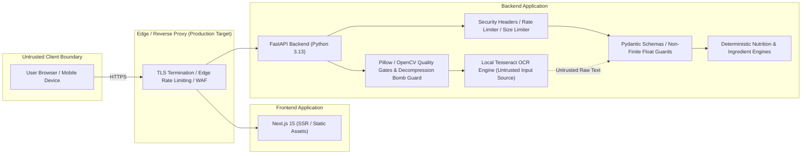

# healthyIndia Security Architecture & Baseline

**Document Version**: 2.2.0  
**Phase**: 4F — Release-Gate Verification and Evidence-Based Readiness  
**Date**: October 19, 2026  
**System Production Status**: **NOT READY FOR PRODUCTION** (Physical OCR benchmark remains **UNMEASURED**)  

---

## 1. Threat Model & Trust Boundaries

healthyIndia evaluates packaged food labels against Indian statutory standards (FSSAI) and dietary references (ICMR-NIN). The application processes untrusted client inputs and food packaging images.



### Trust Boundary Rules
1. **Client is Untrusted**: All data originating from the client (web browser, mobile device, or API client) is treated as potentially adversarial. No client-side assertion or validation is trusted by the backend.
2. **OCR Output is Untrusted**: Text produced by optical character recognition (OCR) is machine-generated draft text. It is never treated as authoritative nutrition data until the user inspects, verifies, and confirms the values through an authenticated session.
3. **Deterministic Separation**: Nutrition calculations and ingredient matching are pure, deterministic Python evaluations. No generative AI or probabilistic cloud APIs are used, preventing prompt injection, hallucinated claims, or unpredictable safety evaluations.

---

## 2. Implemented Defense-in-Depth Controls

### A. Input Validation & Mathematical Plausibility
- **Strict Pydantic V2 Schemas**: All JSON request bodies are validated against rigid schemas (`NutritionAnalysisRequest`, `IngredientAnalysisRequest`, `OcrConfirmationRequest`).
- **Non-Finite Numerical Rejection**: Non-finite float values (`NaN`, `Infinity`, `-Infinity`) are explicitly rejected fail-closed on all numeric fields (serving sizes, nutrient amounts).
- **Physical & Biological Plausibility Checks**:
  - Nutrients cannot be negative.
  - Added sugar cannot exceed total sugar (+ 0.05g tolerance).
  - Total sugar cannot exceed total carbohydrates (+ 0.05g tolerance).
  - Sum of saturated and trans fats cannot exceed total fat (+ 0.05g tolerance).
  - Macronutrient sum cannot exceed 105g on a 100g serving basis.
  - Energy must be plausible relative to declared fat calories (min 8.0 kcal/g fat).
- **Missing vs. Zero Distinction**: Omitted nutrients are preserved as `None` rather than silently defaulted to `0.0`.

### B. Upload & Image Processing Security
- **Strict Size Limits**: Uploaded image payloads are capped at 10 MB (`MAX_IMAGE_UPLOAD_BYTES = 10_485_760`).
- **Content-Based Magic Byte & Structure Verification**: Files are verified using Pillow's `Image.open().verify()` and format detection; client-supplied filenames, extensions, and Content-Type headers are strictly untrusted.
- **Authorized Formats Only**: Allowed formats are restricted to `{"JPEG", "PNG", "WEBP"}`. Executables, scripts, HTML, and vector SVGs are rejected.
- **Decompression Bomb Protection**: Pillow's pixel limit is enforced globally at 16 Megapixels (`Image.MAX_IMAGE_PIXELS = 16_000_000`, `MAX_IMAGE_DIMENSION = 4096`).
- **Disk Retention Lifecycle**:
  - Image payloads <= 1 MB remain strictly in-memory buffers (`io.BytesIO`).
  - Multipart uploads > 1 MB are transiently spooled to an OS temporary file by Starlette's `SpooledTemporaryFile` during multipart body parsing, and are unlinked immediately when the request finishes.
  - No permanent application disk retention exists.
- **No Upload Logging**: Image byte contents, EXIF metadata, and user photos are never written to log files.

### C. API Abuse, Rate Limiting & Request Sizing
- **Thread-Safe In-Memory Sliding-Window Rate Limiter**:
  - Protected by `threading.Lock()` against concurrent race conditions.
  - Bounded memory usage: enforces `max_tracked_clients` with automatic pruning and FIFO eviction of stale client records.
  - Route limits:
    - `/api/v1/extraction/ocr`: 10 requests / minute (heavy local OCR execution)
    - `/api/v1/extraction/confirm`: 30 requests / minute
    - `/api/v1/nutrition/analyze`: 60 requests / minute
    - `/api/v1/ingredients/analyze`: 60 requests / minute
    - General endpoints: 120 requests / minute
- **Anti-Spoofing Client IP Resolution**:
  - `X-Forwarded-For` and `CF-Connecting-IP` headers are **strictly ignored** unless the direct connecting IP address matches a trusted reverse proxy configured in `TRUSTED_PROXIES`.
  - Untrusted clients cannot evade rate limits by rotating forwarded headers.
- **HTTP 429 Responses**: Returns structured JSON error responses with standard `Retry-After` and `X-RateLimit-Remaining` headers.
- **CORS Preflight Bypass**: `OPTIONS` requests are exempt from rate limiting to prevent blocking legitimate cross-origin preflight checks.
- **Request Size Limiting & Streaming Body Bounds**:
  - Standard JSON endpoints are bounded at 1 MB (`MAX_REQUEST_BODY_BYTES = 1_048_576`).
  - Defends against negative `Content-Length` headers (HTTP 400).
  - Defends against misleading small `Content-Length` headers by enforcing running byte limits during stream consumption (HTTP 413).
  - Chunked streaming bodies without `Content-Length` headers are incrementally byte-counted and rejected with HTTP 413 if the limit is exceeded.
  - Handles `ClientDisconnect` safely without 500 server errors.

### D. Session Integrity & Cryptographic Tokens
- **Fail-Closed Session Confirmation**: Confirming reviewed OCR values requires an active, unexpired server session stored in `session_store`. Expired or missing sessions return HTTP 404/400.
- **Server-Keyed HMAC Signatures**:
  - Extraction session token: `v1.<id>.<ts>.<sig>`
  - Confirmation token: `c1.<id>.<digest>.<ts>.<sig>`
  - Uses `hmac.compare_digest` for constant-time string comparison to prevent timing side-channel attacks.
  - Validates canonical UUID structure on all extraction identifiers.
  - Cryptographically binds the canonical SHA-256 digest of confirmed nutrition values to the extraction ID and server secret key. Client tampering alters the expected digest and fails server-side verification.

### E. Browser Security, CORS, and Headers
- **Backend API Security Headers Middleware**:
  - `X-Content-Type-Options: nosniff`
  - `X-Frame-Options: DENY`
  - `Referrer-Policy: strict-origin-when-cross-origin`
  - `Content-Security-Policy: default-src 'none'; frame-ancestors 'none';` (API never renders HTML or executes scripts)
  - `Permissions-Policy: camera=(), microphone=(), geolocation=(), payment=()`
  - `X-XSS-Protection: 0`
  - `Strict-Transport-Security: max-age=63072000; includeSubDomains; preload` (enforced in production)
- **Frontend Web Security Headers (`next.config.mjs`)**:
  - `Content-Security-Policy`:
    ```
    default-src 'self';
    script-src 'self' 'unsafe-inline';
    style-src 'self' 'unsafe-inline';
    img-src 'self' blob: data:;
    font-src 'self';
    connect-src 'self' http://127.0.0.1:8000 http://localhost:8000 https://healthyindia.com;
    frame-ancestors 'none';
    object-src 'none';
    base-uri 'self';
    form-action 'self';
    ```
    - `img-src 'self' blob: data:` explicitly permits local client-side image preview URLs generated by the camera scanner without allowing untrusted third-party images.
  - `Permissions-Policy: camera=(self), microphone=(), geolocation=()` to permit HTML5 camera capture while disabling unused device sensors.
- **Restrictive CORS**:
  - Configurable `ALLOWED_ORIGINS` (defaults to local development origins).
  - Wildcard `*` is strictly prohibited in production and staging.
  - Localhost origins (`localhost`, `127.0.0.1`) are prohibited when `ENVIRONMENT=production`.
  - `allow_credentials=False` (anonymous API).

### F. Configuration & Secrets
- **Environment Isolation**:
  - In production and staging, `DEBUG` must be `False`.
  - `SECRET_KEY` must be at least 32 characters and cannot contain insecure placeholder words (`insecure`, `changeme`, `default`).
  - Interactive OpenAPI documentation (`/docs`, `/redoc`, `/openapi.json`) is disabled in production by default.

---

## 3. Dependency Security Audit & Remediation (Phase 4E)

### Frontend Audit Results (`pnpm audit`)

| Advisory ID | Package | Vulnerable Range | Severity | Status in Phase 4E | Remediation / Justification |
| :--- | :--- | :--- | :--- | :--- | :--- |
| **GHSA-5gmw-xhrv-c9v3** | `tinypool` | `<=2.1.0` | **Critical** | **RESOLVED** | Upgraded to `vitest@4.1.12`, which completely removes `tinypool` in favor of native worker threads and tinyexec. |
| **GHSA-85c8-ppgw-ccpr** | `tinypool` | `<2.1.2` | **Critical** | **RESOLVED** | Upgraded to `vitest@4.1.12` (tinypool removed from dependency graph). |
| **GHSA-82fw-gwwq-j7x9** | `vitest` / `@vitest/mocker` | `>=2.1.0 <4.1.11` | Moderate | **RESOLVED** | Upgraded to `vitest@4.1.12` (includes `@vitest/mocker@4.1.12`). |
| **GHSA-qx2v-qp2m-jg93** | `postcss` | `<8.5.10` | Moderate | **RESOLVED** | Overridden to `postcss@8.5.31` in `pnpm-workspace.yaml`. |
| **GHSA-6g55-p6wh-862q** | `postcss` | `<=8.5.11` | High | **RESOLVED** | Overridden to `postcss@8.5.31` in `pnpm-workspace.yaml`. |
| **GHSA-fxqj-rqcc-2cmp** | `postcss` | `<=8.5.22` | Moderate | **RESOLVED** | Overridden to `postcss@8.5.31` in `pnpm-workspace.yaml`. |
| **GHSA-r28c-9q8g-f849** | `postcss` | `<=8.5.17` | High | **RESOLVED** | Overridden to `postcss@8.5.31` in `pnpm-workspace.yaml`. |
| **GHSA-vfj7-8cjw-p6xm** | `braces` | `<=3.0.3` | High | **Accepted Exception** | Documented temporary exception SEC-EXC-2026-001. No upstream patch available on npm. Dev-only linting tool. |

#### Formal Security Exception: SEC-EXC-2026-001 (`braces`)

- **Advisory ID**: GHSA-vfj7-8cjw-p6xm (CWE-674: Stack-exhaustion denial of service through deeply nested patterns)
- **Package Identity**: `braces` (npm)
- **Affected Version**: `3.0.3` (installed: `3.0.3`, latest published: `3.0.3`)
- **Full Dependency Path**:
  `apps/web > eslint-config-next@15.5.28 > @next/eslint-plugin-next@15.5.28 > fast-glob@3.3.1 > micromatch@4.0.8 > braces@3.0.3`
- **Demonstrated Exposure Assessment**:
  1. `pnpm list --prod` confirms `braces` is **absent** from the production runtime dependency graph (only `next`, `react`, and `react-dom` are included in production).
  2. Production build inspection of `apps/web/.next` confirms **zero** occurrences of `braces` in packaged client or server JavaScript output.
  3. The vulnerable code path (`braces.expand()`) is invoked exclusively by `fast-glob` during static linting (`pnpm run lint`) to locate repository source files.
  4. Attacker-controlled HTTP inputs, label images, or public web traffic cannot reach `braces`.
- **Compensating Controls**:
  - Execution is strictly restricted to local development environments and ephemeral GitHub Actions CI runner virtual machines.
  - `pnpm install --frozen-lockfile` prevents arbitrary supply chain injection.
  - Secret scanning via Gitleaks runs on all commits.
- **Accountable Owner**: healthyIndia Engineering Security & Quality Lead.
- **Review & Expiry Date**: November 30, 2026 (or next major Next.js / ESLint dependency release).
- **Conditions for Removing Exception**:
  - Publication of a patched `braces` release on npm, or upstream upgrade by `eslint-config-next` / `fast-glob`.

### Backend Python Audit Results (`pip-audit`)
- Tool: `pip-audit` via official PyPI vulnerability database.
- Packages audited: 28 installed packages in backend environment.
- Result: **`No known vulnerabilities found`**.

---

## 4. Knowledge Base Evidence Validator Scope & Boundaries

healthyIndia enforces an explicit separation between automated tooling and human expert review across three distinct verification tiers:

### Tier A: Automated Schema & Consistency Validation
Automated CI checks (`validate_ingredient_kb.py`) deterministically verify structural and lexical invariants:
- **Record completeness**: All required fields, functional classes, and identifiers (canonical ID, INS number, CAS number) conform to schemas.
- **Collision avoidance**: Cryptographic SHA-256 dataset checksum, zero duplicate canonical IDs, zero alias collisions across records, and zero bare numeric aliases (which cause false positives).
- **Anti-hyperbole lexical enforcement**: Prohibits absolute safety claims (e.g., "completely harmless", "zero risk", "100% safe") in text fields.
- **Additive scope completeness**: Food additives declare explicit technological categories and scope limitations.

### Tier B: Source Metadata & URL Domain Checks
Automated checks ensure that references originate from authoritative, transparent sources:
- **Domain allowlisting**: Citation URLs belong strictly to recognized public health and statutory authorities (`fssai.gov.in`, `who.int`, `efsa.europa.eu`, `nih.gov`, `codexalimentarius.org`, `icmr.nic.in`, `nin.res.in`).
- **Citation metadata**: Every citation record contains title, organization, URL, source type, and retrieval date.
- **Offline verification**: CI does not perform live network HTTP calls (which could fail due to network volatility); URL syntax and allowlists are evaluated deterministically offline.

### Tier C: Human Review of Primary Sources
Independent scientific or statutory authority is **never** computationally claimed merely because CI passes:
- **Primary source inspection**: Specific statutory acts (e.g., FSSAI Food Products Standards and Food Additives Regulations, 2011; Labelling and Display Regulations, 2020) and scientific monographs (JECFA WHO Technical Report Series, EFSA opinions) must be audited by qualified food-science auditors.
- **Provenance records**: Provenance flags (`source_content_checked`, `scientific_review_status`, `regulatory_verification_status`) record the completion of manual verification by human reviewers; automated CI asserts only that this audit metadata is present, schema-compliant, and accompanied by specific statutory clauses and audit dates.
- **Boundary of claims**: healthyIndia does not claim independent clinical discovery or universal regulatory clearance; it provides structured transparency into published statutory schedules and international toxicological consensus.

---

## 5. Known Limitations & Residual Risks

1. **Multi-Worker Rate Limiting**: The current in-memory sliding window rate limiter operates within a single Python process. In a distributed multi-worker deployment, an edge reverse proxy (such as Nginx `limit_req` or Cloudflare WAF) or a shared Redis token bucket must be configured to enforce cluster-wide IP rate limits.
2. **Physical OCR Performance**: As benchmarked against synthetic and digital fixture data, physical camera label OCR accuracy remains **UNMEASURED**. OCR must remain strictly an untrusted convenience feature requiring full human verification and manual correction.
3. **Session Store Volatility**: The default in-memory session store resets on application restart. Persistent distributed session stores (e.g., Redis with encryption in transit) are required for high-availability clustered deployments.

---

## 6. Safe Vulnerability Reporting

If you identify a security vulnerability in healthyIndia:
1. **Do not open a public issue** on GitHub.
2. Report the vulnerability privately via GitHub Private Vulnerability Reporting or to project maintainers.
3. Include detailed reproduction steps, request payloads, and affected component versions.
4. Maintain coordinated disclosure until an audited patch has been released.
