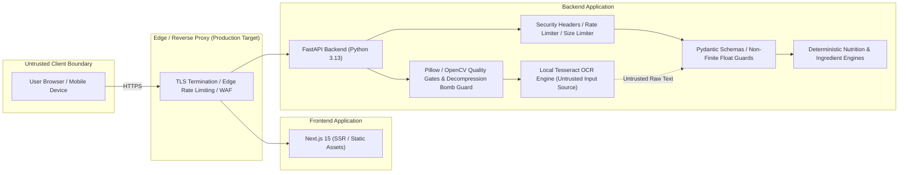

# healthyIndia Security Architecture & Baseline

**Document Version**: 2.0.0  
**Phase**: 4D — Security Hardening, Evidence Audit, and Controlled Catalogue Expansion  
**Date**: October 19, 2026  
**System Production Status**: **NOT READY FOR PRODUCTION** (Physical OCR benchmark remains **UNMEASURED**)  

---

## 1. Threat Model & Trust Boundaries

healthyIndia evaluates packaged food labels against Indian statutory standards (FSSAI) and dietary references (ICMR-NIN). The application processes untrusted client inputs and food packaging images.

### Trust Boundary Rules
1. **Client is Untrusted**: All data originating from the client (web browser, mobile device, or API client) is treated as potentially adversarial. No client-side assertion or validation is trusted by the backend.
2. **OCR Output is Untrusted**: Text produced by optical character recognition (OCR) is machine-generated draft text. It is never treated as authoritative nutrition data until the user inspects, verifies, and confirms the values through an authenticated session.
3. **Deterministic Separation**: Nutrition calculations and ingredient matching are pure, deterministic Python evaluations. No generative AI or probabilistic cloud APIs are used, preventing prompt injection, hallucinated claims, or unpredictable safety evaluations.

---

## 2. Implemented Defense-in-Depth Controls

### A. Input Validation & Mathematical Plausibility
- **Strict Pydantic V2 Schemas**: All JSON request bodies are validated against rigid schemas (`NutritionAnalysisRequest`, `IngredientAnalysisRequest`, `OcrConfirmationRequest`).
- **Non-Finite Numerical Rejection**: Non-finite float values (`NaN`, `Infinity`, `-Infinity`) are explicitly rejected fail-closed on all numeric fields (serving sizes, nutrient amounts).
- **Physical & Biological Plausibility Checks**:
  - Nutrients cannot be negative.
  - Added sugar cannot exceed total sugar (+ 0.05g tolerance).
  - Total sugar cannot exceed total carbohydrates (+ 0.05g tolerance).
  - Sum of saturated and trans fats cannot exceed total fat (+ 0.05g tolerance).
  - Macronutrient sum cannot exceed 105g on a 100g serving basis.
  - Energy must be plausible relative to declared fat calories (min 8.0 kcal/g fat).
- **Missing vs. Zero Distinction**: Omitted nutrients are preserved as `None` rather than silently defaulted to `0.0`.

### B. Upload & Image Processing Security
- **Strict Size Limits**: Uploaded image payloads are capped at 10 MB (`MAX_IMAGE_UPLOAD_BYTES = 10_485_760`).
- **Content-Based Magic Byte & Structure Verification**: Files are verified using Pillow's `Image.open().verify()` and format detection; client-supplied filenames, extensions, and Content-Type headers are strictly untrusted.
- **Authorized Formats Only**: Allowed formats are restricted to `{"JPEG", "PNG", "WEBP"}`. Executables, scripts, HTML, and vector SVGs are rejected.
- **Decompression Bomb Protection**: Pillow's pixel limit is enforced at 16 Megapixels (`Image.MAX_IMAGE_PIXELS = 16_000_000`, `MAX_IMAGE_DIMENSION = 4096`).
- **In-Memory Zero Disk Retention**: Images are processed entirely within memory buffers (`io.BytesIO`). No temporary files are written to the server filesystem, structurally eliminating local file inclusion (LFI), path traversal in filenames, and uncleaned temporary files.
- **No Upload Logging**: Image byte contents, EXIF metadata, and user photos are never written to log files.

### C. API Abuse & Rate Limiting
- **In-Memory Sliding-Window Rate Limiter**:
  - `/api/v1/extraction/ocr`: 10 requests / minute (heavy local OCR execution)
  - `/api/v1/extraction/confirm`: 30 requests / minute
  - `/api/v1/nutrition/analyze`: 60 requests / minute
  - `/api/v1/ingredients/analyze`: 60 requests / minute
  - General endpoints: 120 requests / minute
- **HTTP 429 Responses**: Returns structured JSON error responses with standard `Retry-After` and `X-RateLimit-Remaining` headers.
- **CORS Preflight Bypass**: `OPTIONS` requests are exempt from rate limiting to prevent blocking legitimate cross-origin preflight checks.
- **Request Size Limiting & Streaming Protection**:
  - Standard JSON endpoints are bounded at 1 MB (`MAX_REQUEST_BODY_BYTES = 1_048_576`).
  - Streaming / chunked bodies without `Content-Length` headers are incrementally byte-counted and rejected with HTTP 413 if the limit is exceeded.

### D. Session Integrity & Cryptographic Tokens
- **Fail-Closed Session Confirmation**: Confirming reviewed OCR values requires an active, unexpired server session stored in `session_store`. Expired or missing sessions return HTTP 404/400.
- **Server-Keyed HMAC Signatures**:
  - Extraction session token: `e1.<id>.<ts>.<sig>`
  - Confirmation token: `c1.<id>.<digest>.<ts>.<sig>`
  - The confirmation token cryptographically binds the canonical SHA-256 digest of confirmed nutrition values to the extraction ID and server secret key. Client tampering alters the expected digest and fails server-side verification.

### E. Browser Security, CORS, and Headers
- **Security Headers Middleware**:
  - `X-Content-Type-Options: nosniff`
  - `X-Frame-Options: DENY`
  - `Referrer-Policy: strict-origin-when-cross-origin`
  - `Content-Security-Policy: default-src 'none'; frame-ancestors 'none';`
  - `Permissions-Policy: camera=(), microphone=(), geolocation=(), payment=()`
  - `X-XSS-Protection: 0`
  - `Strict-Transport-Security: max-age=63072000; includeSubDomains; preload` (enforced in production)
- **Restrictive CORS**:
  - Configurable `ALLOWED_ORIGINS` (defaults to local development origins).
  - Wildcard `*` is strictly prohibited in production and staging.
  - Localhost origins (`localhost`, `127.0.0.1`) are prohibited when `ENVIRONMENT=production`.
  - `allow_credentials=False` (anonymous API).

### F. Configuration & Secrets
- **Environment Isolation**:
  - In production and staging, `DEBUG` must be `False`.
  - `SECRET_KEY` must be at least 32 characters and cannot contain insecure placeholder words (`insecure`, `changeme`, `default`).
  - Interactive OpenAPI documentation (`/docs`, `/redoc`, `/openapi.json`) is disabled in production by default.

---

## 3. Dependency Security Audit & Limitations

An automated dependency scan was conducted using `pnpm audit` for frontend packages.

### Frontend Audit Results (`pnpm audit`)
- **Total Vulnerabilities**: 9 (4 Moderate, 3 High, 2 Critical)
- **Critical Severity**:
  - `tinypool` (<=2.1.0, patched in >=2.1.2): Prototype Pollution in worker options (GHSA-5gmw-xhrv-c9v3, GHSA-85c8-ppgw-ccpr). Transitive dependency of `vitest` (development test runner only; not included in production web build).
- **High Severity**:
  - `postcss` (<=8.5.17, patched in >=8.5.18): Path traversal in sourceMappingURL auto-loading (GHSA-r28c-9q8g-f849). Transitive dependency of `next`.
  - `braces` (<=3.0.3, no official patch available): Stack-exhaustion DoS through deeply nested patterns (GHSA-vfj7-8cjw-p6xm). Transitive dependency of `eslint-config-next`.
- **Mitigation & Strategy**:
  - The critical findings reside strictly in test tools (`vitest`), not production bundles.
  - Automated indiscriminate upgrades were avoided to prevent breaking Next.js 15 / React 19 compatibility. Lockfiles remain pinned, and dependency upgrades must be evaluated in dedicated maintenance cycles.

### Python Backend Environment
- Dependencies are locked via `uv.lock`.
- `pip` is omitted in the execution virtual environment. Automated Python audits are conducted via CI using `gitleaks` and `ruff`.

---

## 4. Known Limitations & Residual Risks

1. **Multi-Worker Rate Limiting**: The current in-memory sliding window rate limiter operates within a single Python process. In a distributed multi-worker deployment, an edge reverse proxy (such as Nginx `limit_req` or Cloudflare WAF) must be configured to enforce cluster-wide IP rate limits.
2. **Physical OCR Performance**: As benchmarked against synthetic data only, physical camera label OCR accuracy remains **UNMEASURED**. OCR must remain strictly an untrusted convenience feature requiring full human confirmation.
3. **Session Store Volatility**: The default in-memory session store resets on application restart. Persistent distributed session stores (e.g., Redis with encryption in transit) are required for high-availability clustered deployments.

---

## 5. Safe Vulnerability Reporting

If you identify a security vulnerability in healthyIndia:
1. **Do not open a public issue** on GitHub.
2. Report the vulnerability privately to: `security@healthyindia.com` (or project maintainers via GitHub Private Vulnerability Reporting).
3. Include detailed reproduction steps, request payloads, and affected component versions.
4. Maintain coordinated disclosure until an audited patch has been released.
